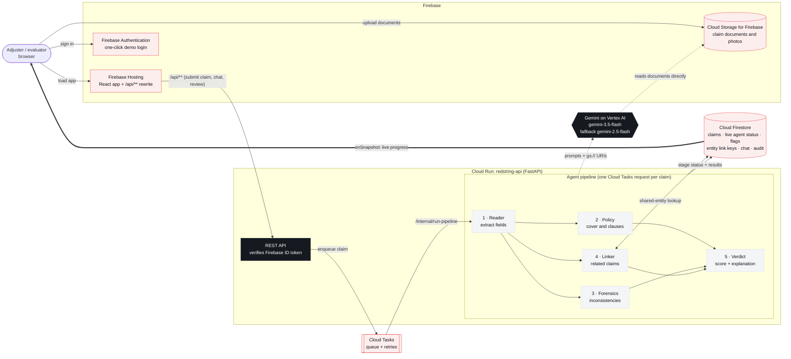

# Redstring

**Connect the dots on every claim.**

Redstring is an AI copilot for motor-insurance claim adjusters. Drop in a claim pack (claim form, repair invoice, photos, police report) and five Gemini-powered agents read every document, check it against the policy wording, look for inconsistencies, and link the claim to every other claim that shares a phone number, bank account, garage, invoice or even an identical photo. The adjuster gets a risk score, evidence for every flag, the exact policy clauses involved, and a recommended next step, in under a minute.

> Rules check claims one at a time. Fraud works in networks.

**Live demo:** https://redstring-511910.web.app (click *Enter demo as adjuster*)

**Benchmark** (held-out set of 32 synthetic claims, [details](docs/benchmark.md)): 95% precision, 100% recall, 1 of 14 clean claims falsely flagged, ~18 s median triage, ≈$0.036 (₹3.0) of Gemini per claim.

---

## What it does

| Agent | What it does | How |
|---|---|---|
| **Reader** | Extracts claimant, vehicle, incident, invoice line items and photo observations from PDFs and images | Gemini multimodal, structured JSON output, documents passed straight from Cloud Storage |
| **Policy** | Checks cover, exclusions, deductible and missing documents; cites clause numbers verbatim | Deterministic schedule checks + Gemini over the full policy wording (long context) |
| **Forensics** | Invoice dated before the incident, arithmetic errors, claim above invoice, photo vs. narrative mismatch, signs of old damage | Deterministic rules + Gemini vision review |
| **Linker** | Finds every claim sharing a phone, email, bank account, vehicle, garage, invoice number or identical photo; detects rings and garages with confirmed-fraud history | Firestore `array-contains-any` over normalised entity keys + SHA-256 photo hashes |
| **Verdict** | Reproducible 0–100 risk score from the flags, an action (fast-track / request info / refer to SIU), and a plain-English explanation | Weighted flag severities + Gemini summary |

The adjuster stays in control: confirm or dismiss any flag (the score updates instantly), record a decision, chat with the claim, and draft a request-for-information email or an SIU referral memo. Every action goes to an audit trail.

The **Red String** view shows the whole network: claims connected by shared identifiers, with confirmed-fraud claims highlighted.

## Google Cloud and Firebase

| Service | Used for |
|---|---|
| **Gemini on Vertex AI** (`gemini-3.5-flash`) | All five agents: multimodal document reading, policy reasoning, forensic review, explanations, chat and correspondence drafting |
| **Gemini image generation** (`gemini-3.1-flash-image`) | Generating the synthetic damage photos for the demo data |
| **Cloud Run** | The FastAPI backend (`redstring-api`) running the agent pipeline; scales to zero, CPU billed only while handling requests |
| **Cloud Tasks** | Queues each claim for the pipeline and calls back into Cloud Run, with automatic retries |
| **Firebase Hosting** | Serves the React app and routes `/api/**` to Cloud Run |
| **Firebase Authentication** | One-click anonymous demo login; ID tokens verified by the API on every request |
| **Cloud Firestore** | Claims, live per-agent progress (streamed to the UI with `onSnapshot`), flags, links, chat history, audit trail, policies |
| **Cloud Storage for Firebase** | Uploaded claim documents, read by Gemini directly via `gs://` URIs |

## Architecture



Source: [`docs/architecture.mmd`](docs/architecture.mmd) · PNG: [`docs/architecture.png`](docs/architecture.png)

More: [submission description](docs/submission.md) · [benchmark](docs/benchmark.md) · [demo video script](docs/video-script.md)

## Repository layout

```
backend/            FastAPI app for Cloud Run
  app/agents/       reader, policy, forensics, linker, verdict
  app/rules.py      deterministic checks and risk scoring
  app/policies/     policy wording (fictional insurer)
  scripts/          synthetic data generator, seeding, benchmark
  tests/
frontend/           React + Vite + Tailwind adjuster console
  public/samples/   one-click sample claim packs
firebase.json       Hosting rewrites, Firestore/Storage rules
scripts/            GCP setup and deploy
```

## Run it yourself

```bash
# one-time
./scripts/setup_gcp.sh                       # APIs, Firestore, IAM
cd backend && uv sync
uv run python scripts/seed.py --images       # generate damage photos (once)
uv run python scripts/seed.py --reset        # seed demo world + run agents

# local dev
uv run uvicorn app.main:app --port 8080      # backend (uses ADC)
cd ../frontend && npm install && npm run dev # frontend, proxies /api to :8080

# deploy
./scripts/deploy.sh

# checks
uv run python scripts/e2e.py --submit live-ring   # live end-to-end test as an anonymous user
uv run python scripts/benchmark.py --seed 11      # held-out benchmark -> docs/benchmark.md
uv run python scripts/seed.py --restore           # reset demo claims; deletes ALL non-demo claims, never run during judging
```

Cost controls: the service scales to zero when idle. Before a scheduled review, keep one instance warm so the first request is instant, and turn it off afterwards:

```bash
gcloud run services update redstring-api --region us-central1 --min-instances 1   # warm (~₹25/day)
gcloud run services update redstring-api --region us-central1 --min-instances 0   # scale to zero (~₹0 idle)
```

Demo claims are read-only for evaluators (no re-runs), and each evaluator's queue and Red String view show the demo world plus only their own submissions.

## Demo data

All claimants, policies, garages, phone numbers and bank accounts are **fictional**, generated by `backend/scripts/scenarios.py`. The insurer is "Redstring Demo General Insurance", which does not exist. The demo world contains 59 historical claims (3 confirmed fraud at one garage), 9 demo claims (3 clean, 3 with individual red flags, 3 forming a ring), and 3 sample packs on the *New claim* page, one of which joins the ring live.
